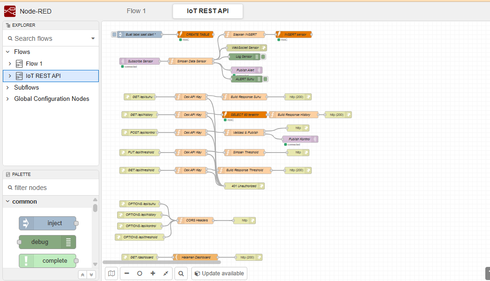
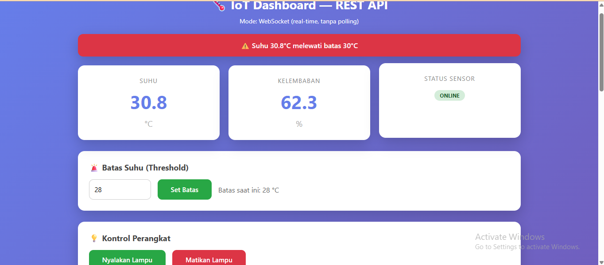
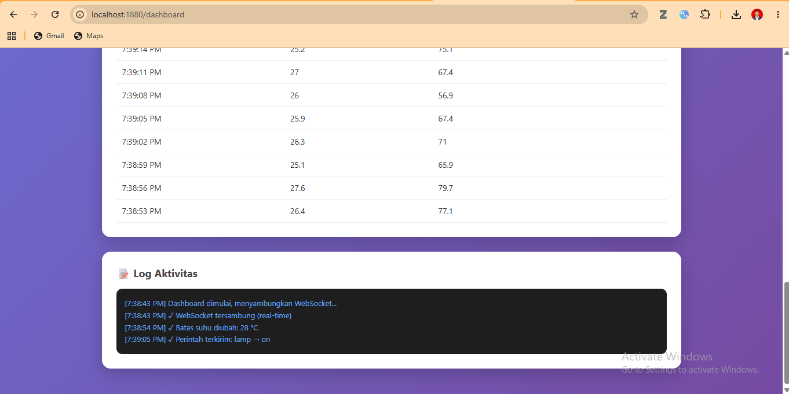
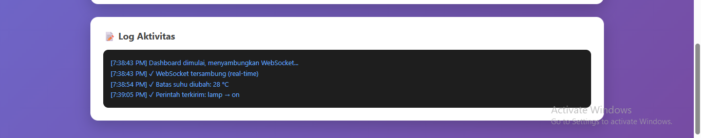

# Tugas Praktek 9 — REST API Node-RED untuk Sistem IoT

Mata kuliah: Pemrograman Internet Of Things (TIF1504)
Nama / NIM: **[isi nama dan NIM]**

Sistem monitoring dan kontrol IoT. ESP32 (disimulasikan dengan Python) mengirim data suhu dan kelembaban lewat MQTT. Node-RED menjadi backend REST API, dan dashboard web menampilkan datanya secara real-time.

## Arsitektur

```
simulasi_esp32.py ──MQTT──▶ Mosquitto ──▶ Node-RED ──REST API──▶ Dashboard (browser)
   (ESP32 palsu)           (broker)       │   ▲                        ▲
                                          │   └── POST /api/kontrol ───┘
                                          ├──WebSocket (/ws/sensor)────┘
                                          └──SQLite (iot_history.db)
```

## Isi repo

| File | Fungsi |
|---|---|
| `flows.json` | Flow Node-RED lengkap (API, MQTT, WebSocket, SQLite, dan halaman dashboard) |
| `dashboard.html` | Kode sumber dashboard (sudah tertanam di `flows.json`, disajikan di `/dashboard`) |
| `simulasi_esp32.py` | Simulator ESP32: publish sensor, menerima perintah kontrol dan alert |
| `screenshots/` | Bukti hasil uji |

## Prasyarat

- Node.js dan Node-RED
- Mosquitto (broker MQTT, port 1883)
- Python 3 dan `paho-mqtt` (`python -m pip install paho-mqtt`)
- Palette Node-RED `node-red-node-sqlite` (☰ → Manage palette → Install)

## Cara menjalankan

Buka 3 jendela CMD dan biarkan terbuka:

```
# CMD 1: broker MQTT
mosquitto -v

# CMD 2: Node-RED
node-red

# CMD 3: simulator ESP32 (di folder repo ini)
python simulasi_esp32.py
```

Lalu di Node-RED (`http://localhost:1880`):

1. ☰ → **Import** → paste isi `flows.json` → **Import**.
2. Klik **Deploy**. Pastikan node *Subscribe Sensor* berstatus hijau **connected**.
3. Buka dashboard: **http://localhost:1880/dashboard**

Catatan: lokasi database SQLite ada di node konfigurasi `sqlitedb` (default `C:\Users\mfadh\iot_history.db`). Ubah path-nya kalau perlu lewat dobel-klik node *INSERT sensor* lalu ikon pensil pada kolom Database.

## Endpoint REST API

Semua endpoint wajib memakai header `X-API-Key: rahasia123`.

| Endpoint | Method | Fungsi |
|---|---|---|
| `/api/suhu` | GET | Data sensor terakhir |
| `/api/history` | GET | 50 data sensor terakhir (dari SQLite) |
| `/api/kontrol` | POST | Kirim perintah ke perangkat (publish MQTT `iot/kontrol`) |
| `/api/threshold` | GET | Baca batas suhu saat ini |
| `/api/threshold` | PUT | Atur batas suhu, body `{"max": 30}` |

Contoh (Windows CMD):

```
curl http://localhost:1880/api/suhu -H "X-API-Key: rahasia123"

curl -X POST http://localhost:1880/api/kontrol -H "Content-Type: application/json" -H "X-API-Key: rahasia123" -d "{\"device\":\"lamp\",\"action\":\"on\"}"

curl -X PUT http://localhost:1880/api/threshold -H "Content-Type: application/json" -H "X-API-Key: rahasia123" -d "{\"max\":28}"
```

Tanpa API key, server membalas **401**: `{"status":"error","message":"API key tidak valid atau tidak ada"}`.

## Tugas pengembangan (nilai tambah)

| No | Tugas | Status | Implementasi |
|---|---|---|---|
| 1 | Endpoint `/api/threshold` (PUT) + notifikasi saat suhu melewati batas | Selesai | PUT menyimpan batas di flow context. Tiap data sensor masuk dibandingkan dengan batas. Jika lewat, dikirim ke panel debug *ALERT Suhu*, MQTT topic `iot/alert`, dan banner merah di dashboard |
| 2 | Grafik real-time Chart.js | Selesai | Grafik garis suhu dan kelembaban (maks. 20 titik) di dashboard |
| 3 | Autentikasi API key `X-API-Key` | Selesai | Node *Cek API Key* di depan setiap endpoint, balasan 401 jika key salah |
| 4 | WebSocket di Node-RED | Selesai | Node `websocket out` di path `/ws/sensor`. Dashboard memakai `ws.onmessage`, dengan polling sebagai cadangan jika koneksi putus |
| 5 | Simpan history ke SQLite | Selesai | Tabel `sensor_history`. Tiap data sensor di-INSERT, `/api/history` membaca 50 data terakhir dari database, sehingga data tetap ada setelah Node-RED di-restart |

## Screenshot

**Flow Node-RED**



**Dashboard: WebSocket, batas suhu, banner peringatan**



**Dashboard: tabel history dan log aktivitas**



**Log aktivitas (WebSocket tersambung, set batas suhu, kontrol lampu)**



## Catatan

- API key `rahasia123` hanya contoh untuk tugas. Ubah di node *Cek API Key* (`var KEY`) dan di `dashboard.html` (`API_KEY`) jika ingin diganti, lalu import ulang atau edit di Node-RED.
- Dashboard sebaiknya dibuka lewat `http://localhost:1880/dashboard`, bukan dengan membuka file `dashboard.html` langsung. Alamat yang sama dengan API menghindari pemblokiran CORS oleh browser.
- Simulator memakai `paho-mqtt` versi 2 (`mqtt.CallbackAPIVersion.VERSION2`).
